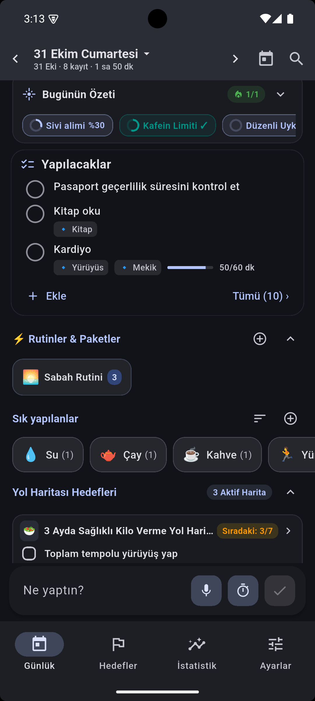
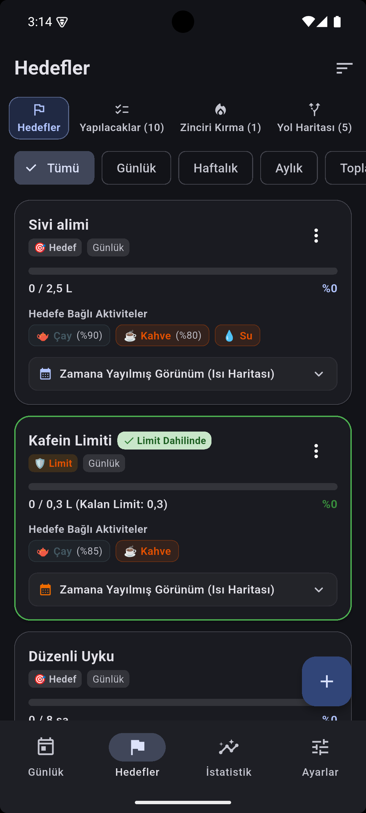
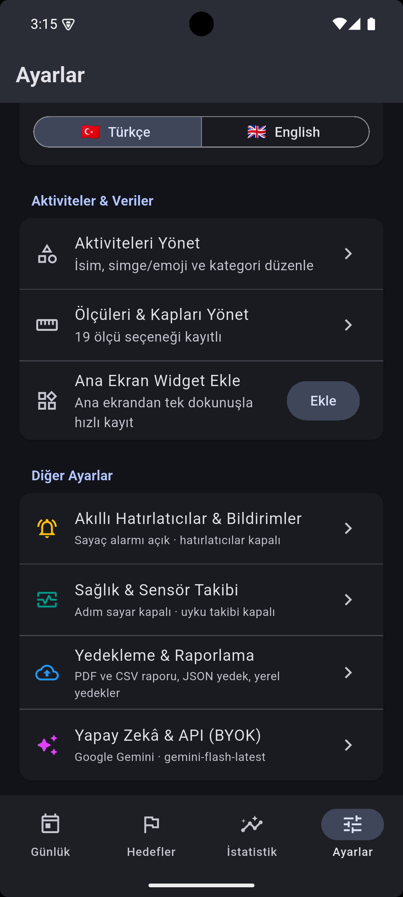

<p align="center">
  
</p>

<h1 align="center">Seyir</h1>

<p align="center"><a href="README.md">Türkçe</a> · <b>English</b></p>

An offline Android app for tracking your daily activities, habits and goals. Data is stored only in a SQLite database on the device. The app connects to the internet in just two cases: to download a roadmap when you add one from a link, and, in the optional AI feature, to have the provider you chose generate a roadmap with your own API key. Voice input uses the device's speech recognition service.

| Journal | Goals | Settings |
| :---: | :---: | :---: |
|  |  |  |

The screenshots show the Turkish interface; the language can be switched to English in Settings.

## Features

- **Journal:** free-text logging in Turkish or English, such as "30 min run" or "2 bardak su" (2 glasses of water), with a preview of what will be saved as you type; voice input, stopwatch / countdown / pomodoro, the day's timeline, sleep and step tracking.
- **To-dos:** a to-do linked to an activity progresses with that activity's entries (e.g. 60 min of cardio); to-dos have their own home-screen widget.
- **Goals:** daily, weekly, monthly and all-time goals and limits, streaks and a heatmap for habits, roadmaps (added by hand, from a shared https link, or with AI: through a ready-made prompt template or your own API key). Roadmap steps can be linked to an activity: the activity's entries advance the step, and the step completes itself once its target is reached.
- **Stats:** day / week / month / year views, comparison with the previous period, category breakdown.
- **Settings:** theme and language (Turkish / English), activity and unit management, notifications and reminders, home-screen widgets, JSON backup (including an automatic daily local backup), PDF and CSV export, AI provider (Gemini, OpenAI, OpenRouter).

## Install

Download the APK for your phone from the [Releases](https://github.com/muratboy/seyir/releases) page and install it: `arm64-v8a` for most phones, `armeabi-v7a` for older 32-bit phones, `x86_64` for emulators and Chromebooks. Each release comes with a `SHA256SUMS.txt` file to verify the downloads.

Once Seyir is on F-Droid, the F-Droid build will be signed with F-Droid's own key, so it cannot update an install from GitHub (or the other way round). To switch, take a JSON backup before uninstalling and restore it in the new install.

## Build and test

```sh
flutter pub get
flutter run                    # connected device or emulator
flutter analyze
flutter test                   # runs against real SQLite; libsqlite3 must be installed
flutter build apk --release
```

## Folders

| Folder | Contents |
| --- | --- |
| `lib/data` | Database (`db.dart`), models, app state and business logic (`store.dart`) |
| `lib/logic` | Formatting, localization, text matching, period statistics |
| `lib/services` | Notifications, backup, export, voice input, step sensor, text and roadmap parsers |
| `lib/ui` | Pages and components |
| `android` | Android project: home-screen widgets, notification icons, R8 rules |
| `test` | Unit and widget tests (real SQLite setup: `test/support/real_db.dart`) |
| `assets/fonts` | Noto Sans font |
| `fastlane/metadata/android` | F-Droid store listing: descriptions, icon and screenshots (also shown in this README) |

## License

Copyright © 2026 Murat Boy

Seyir is free software: you can redistribute it and/or modify it under the terms of version 3 of the GNU General Public License (GPL-3.0-only). It is provided without any warranty. The full license text is in [LICENSE](LICENSE).

The bundled Noto Sans font is licensed under the SIL Open Font License 1.1: [assets/fonts/OFL.txt](assets/fonts/OFL.txt).
