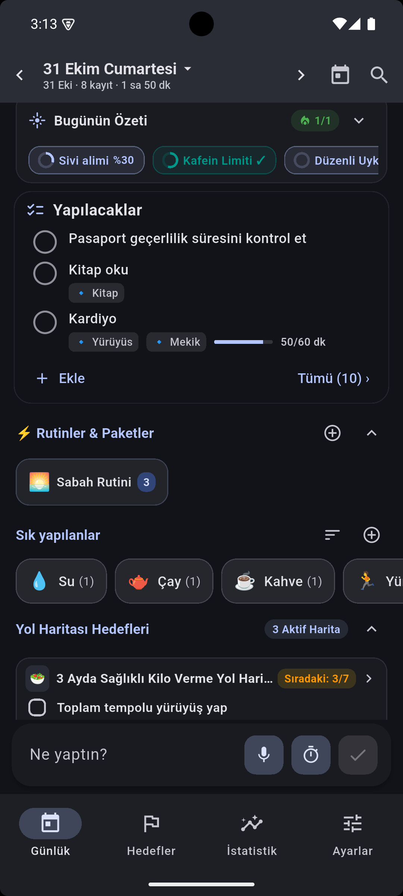
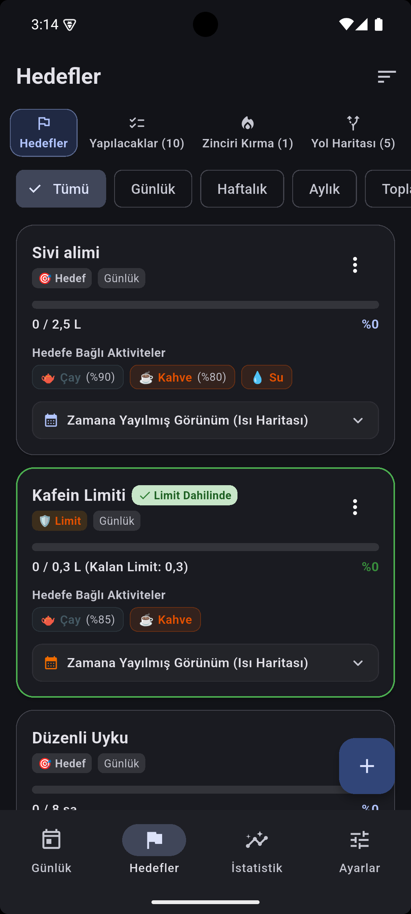
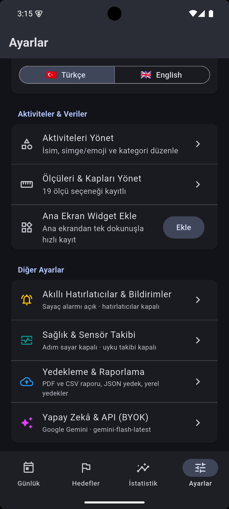

<p align="center">
  
</p>

<h1 align="center">Seyir</h1>

<p align="center"><b>Türkçe</b> · <a href="README.en.md">English</a></p>

Günlük aktivitelerini, alışkanlıklarını ve hedeflerini takip eden, çevrimdışı çalışan bir Android uygulaması. Veriler yalnızca cihazdaki SQLite veritabanında tutulur. Uygulama internete yalnızca iki durumda bağlanır: bir bağlantıdan yol haritası eklerken o bağlantıyı indirmek için ve isteğe bağlı yapay zekâ özelliğinde, kendi API anahtarınızla seçtiğiniz sağlayıcıya yol haritası oluşturtmak için. Sesle giriş, cihazın konuşma tanıma hizmetini kullanır.

| Günlük | Hedefler | Ayarlar |
| :---: | :---: | :---: |
|  |  |  |

## Neler yapar

- **Günlük:** "30 dk koşu", "2 bardak su" gibi serbest metinle kayıt (yazarken ne olacağını gösteren önizlemeyle), sesle giriş, kronometre / geri sayım / pomodoro, günün akışı, uyku ve adım takibi.
- **Yapılacaklar:** bir aktiviteye bağlanan yapılacak, o aktivitenin kayıtlarıyla ilerler (ör. 60 dk kardiyo); yapılacakların kendi ana ekran widget'ı var.
- **Hedefler:** günlük, haftalık, aylık ve toplam hedefler ile limitler, alışkanlıklar için seri ve ısı haritası, yol haritaları (elle, paylaşılan bir https bağlantısından ya da yapay zekâyla: hazır istem kalıbıyla veya kendi API anahtarınızla eklenir). Yol haritası adımları bir aktiviteye bağlanabilir: aktivitenin kayıtları adımı ilerletir, hedefe ulaşılınca adım kendiliğinden tamamlanır.
- **İstatistik:** gün / hafta / ay / yıl görünümleri, önceki dönemle karşılaştırma, kategori dağılımı.
- **Ayarlar:** tema ve dil (Türkçe / İngilizce), aktivite ve ölçü yönetimi, bildirimler ve hatırlatıcılar, ana ekran widget'ları, JSON yedek (günlük otomatik yerel yedek dahil), PDF ve CSV dışa aktarma, yapay zekâ sağlayıcısı (Gemini, OpenAI, OpenRouter).

## Çalıştırma ve test

```sh
flutter pub get
flutter run                    # bağlı cihaz ya da emülatör
flutter analyze
flutter test                   # gerçek SQLite ile çalışır; sistemde libsqlite3 kurulu olmalı
flutter build apk --release
```

## Klasörler

| Klasör | İçerik |
| --- | --- |
| `lib/data` | Veritabanı (`db.dart`), modeller, uygulama durumu ve iş mantığı (`store.dart`) |
| `lib/logic` | Biçimlendirme, yerelleştirme, metin eşleştirme, dönem istatistikleri |
| `lib/services` | Bildirimler, yedek, dışa aktarma, sesli giriş, adım sensörü, metin ve yol haritası çözümleyicileri |
| `lib/ui` | Sayfalar ve bileşenler |
| `android` | Android projesi: ana ekran widget'ları, bildirim simgeleri, R8 kuralları |
| `test` | Birim ve widget testleri (gerçek SQLite altyapısı: `test/support/real_db.dart`) |
| `docs/screenshots` | README'deki ekran görüntüleri |

## Lisans

Copyright © 2026 Murat Boy

Seyir özgür yazılımdır: GNU Genel Kamu Lisansı'nın 3. sürümünün (GPL-3.0-only) koşulları altında yeniden dağıtabilir ve değiştirebilirsiniz. Program hiçbir garanti olmaksızın sunulur. Lisansın tam metni [LICENSE](LICENSE) dosyasındadır.
